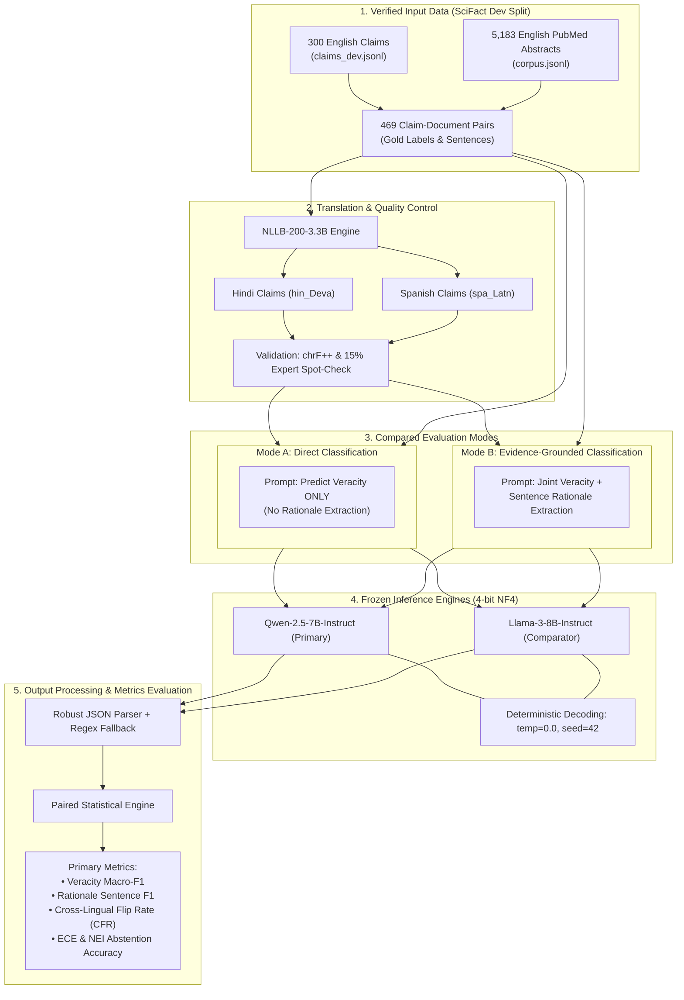

# Experimental Protocol: Matched Multilingual Scientific Claim Verification

**Protocol Version:** 1.0 (Frozen Pre-Experiment Protocol)  
**Date:** 2026-11-04  
**Project:** Cross-Lingual Evidence Grounding in Scientific Claim Verification  
**Author:** Aman Kumar (`mcl2026012@iiita.ac.in`)  
**Institution:** Indian Institute of Information Technology, Allahabad  
**Integrity Rule:** This protocol is frozen **prior** to running final benchmark evaluations or inspecting performance scores. Protocol amendments must be formally logged in `research_decisions.md`.

---

## 1. System Architecture



---

## 2. Experimental Conditions & Factorial Design

The experiment uses a **matched within-subject factorial design** where identical claim-document instances are evaluated across all conditions:

$$\text{Conditions} = 3 \text{ Languages} \times 2 \text{ Task Modes} \times 2 \text{ Model Backbones} = 12 \text{ Experimental Conditions}$$

### 2.1 Language Conditions
1. **English (`en`, Gold Baseline):** Original expert-written claims. Serves as performance ceiling.
2. **Hindi (`hi`, Indic / Lower-Resource):** Devanagari script, non-Latin morphology. Tests cross-script reasoning and subword tokenization robustness.
3. **Spanish (`es`, Romance / High-Resource):** Latin script, high lexical and biomedical cognate overlap with English (e.g., *inhibición*, *mutación*). Tests whether cross-lingual degradation persists even when vocabulary is closely aligned.

*Justification of Language Adequacy:* Both Hindi and Spanish are natively supported by `Qwen-2.5-7B-Instruct`, `Llama-3-8B-Instruct`, and `NLLB-200-3.3B`. If Hindi exhibits excessive translation drift during pre-checks, Google Translate API serves as the verified fallback.

### 2.2 Compared Task Modes
- **Mode A (Direct Classification):** The model receives the claim and evidence abstract and must classify veracity (`SUPPORT`, `CONTRADICT`, `NOT_ENOUGH_INFO`) without an evidence rationale extraction constraint. Tests whether the model can deduce the truth value unconstrained.
- **Mode B (Evidence-Grounded Classification):** The model must simultaneously predict the veracity label **and** identify the exact sentence indices `[s_0, s_1, ...]` in the abstract that justify the verdict. Tests whether veracity judgments are grounded in valid rationales or driven by ungrounded guessing.

---

## 3. Translation & Quality Control Procedure

### 3.1 Translation Pipeline
- **Engine:** Meta `facebook/nllb-200-3.3B` (or 1.3B distilled variant if VRAM constrained).
- **Target Language Tags:** `hin_Deva` for Hindi; `spa_Latn` for Spanish.
- **Input:** The 300 claims in `claims_dev.jsonl`. Abstract evidence texts **remain strictly in English** to reflect the realistic scenario where international researchers query English literature in their native language.

### 3.2 Translation Verification Protocol
1. **Automated Back-Translation:**
   - Translate $C_{\text{en}} \to C_{\text{target}} \to C'_{\text{en}}$.
   - Compute sentence-level **chrF++** (character n-gram F-score) and **BLEU** between $C_{\text{en}}$ and $C'_{\text{en}}$.
   - *Threshold:* Target average $\text{chrF++} \ge 65.0$.
2. **Human Terminological Audit:**
   - A randomly selected 15% sample (45 claims) is manually inspected by a native speaker.
   - Verification checklist:
     - [ ] Chemical/drug names preserved (e.g., *alpha-thalassaemia* not mistranslated into generic terms).
     - [ ] Directional predicates preserved (e.g., *increase* vs. *decrease*, *inhibit* vs. *activate*).
     - [ ] Numerical values and units preserved (e.g., *10μM*, *50 g/l*).
     - [ ] Negations preserved without polarity inversion.

---

## 4. Models, Prompts & Inference Settings

### 4.1 Evaluated Models
1. **Primary Model:** `Qwen/Qwen2.5-7B-Instruct`
   - License: Apache 2.0 (permissive open-source).
   - Context window: 32k tokens.
   - Quantization: 4-bit NormalFloat (NF4) with double quantization via `bitsandbytes`.
2. **Comparator Model:** `meta-llama/Meta-Llama-3-8B-Instruct`
   - License: Meta Llama 3 Community License.
   - Context window: 8k tokens.
   - Quantization: 4-bit NormalFloat (NF4).

### 4.2 Deterministic Decoding Parameters
- `temperature`: `0.0` (greedy decoding for strict reproducibility)
- `top_p`: `1.0`
- `do_sample`: `False`
- `max_new_tokens`: `128`
- `random_seed`: `42` (fixed across all runs)

### 4.3 Exact Prompt Templates

#### Mode A: Direct Classification Prompt Template
```text
<|im_start|>system
You are a rigorous scientific fact-checking system.
Analyze the scientific claim against the provided evidence abstract.
Determine whether the abstract supports, contradicts, or provides insufficient information to verify the claim.

You must respond STRICTLY with a valid JSON object matching this schema:
{
  "veracity": "SUPPORT" | "CONTRADICT" | "NOT_ENOUGH_INFO",
  "confidence": <float between 0.0 and 1.0>
}
Do not include any text outside the JSON object.
<|im_end|>
<|im_start|>user
Claim:
{claim_text}

Evidence Abstract:
Title: {abstract_title}
Text:
{abstract_text}

Classification JSON:
<|im_end|>
<|im_start|>assistant
```

#### Mode B: Evidence-Grounded Classification Prompt Template
```text
<|im_start|>system
You are a rigorous scientific fact-checking system.
Analyze the scientific claim against the numbered sentences of the provided evidence abstract.
You must:
1. Identify the exact 0-indexed sentence numbers that contain direct factual evidence supporting or contradicting the claim. If the evidence is insufficient, rationale_sentences must be empty [].
2. Classify the claim as "SUPPORT", "CONTRADICT", or "NOT_ENOUGH_INFO".
3. Provide your confidence score.

You must respond STRICTLY with a valid JSON object matching this schema:
{
  "veracity": "SUPPORT" | "CONTRADICT" | "NOT_ENOUGH_INFO",
  "rationale_sentences": [<list of integer sentence indices>],
  "confidence": <float between 0.0 and 1.0>
}
Do not include any text outside the JSON object.
<|im_end|>
<|im_start|>user
Claim:
{claim_text}

Evidence Abstract:
Title: {abstract_title}
Numbered Sentences:
{numbered_abstract_sentences}

Classification JSON:
<|im_end|>
<|im_start|>assistant
```

---

## 5. Dataset Split & Exact Counts

- **Evaluation Partition:** SciFact Development Split (`claims_dev.jsonl` + `corpus.jsonl`).
- **Claim Count:** Exactly 300 claims.
  - 124 claims with `SUPPORT` ground-truth
  - 64 claims with `CONTRADICT` ground-truth
  - 112 claims with `NOT_ENOUGH_INFO` ground-truth
- **Instance Count (Claim-Document Pairs):** Exactly 469 pairs.
  - 216 `SUPPORT` pairs
  - 122 `CONTRADICT` pairs
  - 131 `NOT_ENOUGH_INFO` pairs
- **Zero Test Set Exposure:** `claims_test.jsonl` is not used.

---

## 6. Primary & Secondary Metrics

| Metric | Level | Formula / Definition | Direction |
| :--- | :--- | :--- | :---: |
| **Veracity Macro-F1** | Claim & Instance | Unweighted mean of F1 scores across `SUPPORT`, `CONTRADICT`, `NOT_ENOUGH_INFO` | $\uparrow$ Higher is better |
| **Strict Rationale F1** | Sentence | True Positive requires both sentence index match **and** correct veracity label | $\uparrow$ Higher is better |
| **Loose Rationale F1** | Sentence | Sentence index overlap regardless of veracity classification label | $\uparrow$ Higher is better |
| **Rationale Precision & Recall** | Sentence | $P = \frac{\|S_{\text{pred}} \cap S_{\text{gold}}\|}{\|S_{\text{pred}}\|}, \quad R = \frac{\|S_{\text{pred}} \cap S_{\text{gold}}\|}{\|S_{\text{gold}}\|}$ | $\uparrow$ Higher is better |
| **Cross-Lingual Flip Rate (CFR)** | Instance | Percentage of identical claims where prediction changes between language pairs: $\text{CFR}(L_1, L_2) = \frac{1}{N} \sum_{i=1}^N \mathbb{I}(\hat{y}_i^{(L_1)} \ne \hat{y}_i^{(L_2)})$ | $\downarrow$ Lower is better |
| **NEI Abstention Accuracy** | Instance (NEI subset) | Accuracy on unanswerable items ($\hat{y} == \text{NOT\_ENOUGH\_INFO}$) | $\uparrow$ Higher is better |
| **Expected Calibration Error (ECE)** | Confidence | $\text{ECE} = \sum_{m=1}^{10} \frac{\|B_m\|}{N} \|\text{acc}(B_m) - \text{conf}(B_m)\|$ | $\downarrow$ Lower is better |

---

## 7. Paired Comparison & Statistical Significance Protocol

Because all conditions evaluate the **exact same 300 claims**:
1. **Paired Bootstrap Resampling:**
   - Sample $B = 1,000$ bootstrap iterations with replacement over claim IDs.
   - Compute metric difference $\Delta = M(L_{\text{target}}) - M(L_{\text{en}})$.
   - Report empirical 95% bootstrap confidence intervals $[q_{0.025}, q_{0.975}]$.
   - Significance threshold: $p < 0.05$ (zero outside 95% CI).
2. **McNemar's Test:**
   - For paired binary classification accuracy comparisons between Mode A vs. Mode B and English vs. Non-English.
3. **Cohen's Kappa ($\kappa$):**
   - Inter-language prediction agreement beyond chance for identical claim items.

---

## 8. Failure Taxonomy & Error Analysis

Every erroneous prediction in Mode B is automatically tagged into one of 5 mutually exclusive error categories:

| Error Category | Code | Operational Definition |
| :--- | :---: | :--- |
| **Rationale Omission** | `ERR_RAT_OMIT` | Veracity label is correct, but the model extracted zero or incorrect rationale sentences ($S_{\text{pred}} \cap S_{\text{gold}} = \emptyset$). |
| **Spurious Evidence Attribution** | `ERR_RAT_SPURIOUS` | The model hallucinated sentence citations that do not support the claim, despite predicting the correct or incorrect veracity label. |
| **Polarity Inversion** | `ERR_POL_INVERT` | The model directly inverted the scientific conclusion (predicted `SUPPORT` when gold is `CONTRADICT`, or vice versa). |
| **Abstention Failure (False Certainty)** | `ERR_NEI_FAIL` | Gold label is `NOT_ENOUGH_INFO`, but the model generated a confident `SUPPORT` or `CONTRADICT` prediction with fabricated rationales. |
| **Terminological Drift Error** | `ERR_TRANS_DRIFT` | Direct analysis reveals the translation altered a key biomedical entity (gene, compound, dosage, negation), causing the downstream error. |

---

## 9. Handling Missing Outputs & Invalid Predictions

To ensure complete experimental auditability without silent data dropping:
1. **First-Pass JSON Parser:** Attempt native `json.loads()` on model response.
2. **Regex Fallback Parser:** If native JSON fails due to extraneous text or formatting errors:
   - Extract veracity label via case-insensitive regex: `\b(SUPPORT|CONTRADICT|REFUTE|NOT_ENOUGH_INFO|NEI)\b`.
   - Extract sentence integers via regex: `\[([0-9,\s]*)\]`.
   - Extract confidence float via regex: `(?:"confidence"|confidence)\s*:\s*([0-9]*\.?[0-9]+)`.
3. **Hard Failure Handling:**
   - If response cannot be parsed after regex fallback:
     - `veracity = "INVALID_OUTPUT"`
     - `rationale_sentences = []`
     - `confidence = 0.0`
   - **Penalty Rule:** Invalid outputs are **never discarded or omitted** from the denominator; they count as incorrect predictions ($0.0$ reward) to prevent models with brittle syntax from gaining an artificial performance advantage.
   - All unparseable raw outputs are saved to `results/unparseable_outputs.log`.

---

## 10. Hardware, Environment & Runtime Budget

- **Target Compute:** Google Colab Free Tier (Single 15GB NVIDIA T4 GPU) or local CUDA GPU.
- **Quantization:** 4-bit NormalFloat (NF4) using `bitsandbytes` + `accelerate`.
- **Runtime Measurement Protocol:**
  - Track per-instance inference latency (ms) via `time.perf_counter()`.
  - Track peak GPU memory allocation via `torch.cuda.max_memory_allocated()`.
  - Sequential model loading: NLLB translation runs first $\to$ model unloaded $\to$ Qwen-2.5 runs $\to$ cache cleared $\to$ Llama-3 runs.
- **Estimated Execution Budget:**
  - Translation: 300 claims $\times$ 2 languages = 600 calls ($\approx 10$ minutes).
  - Mode A (Direct): 469 pairs $\times$ 3 languages $\times$ 2 models = 2,814 passes ($\approx 60$ minutes).
  - Mode B (Grounded): 469 pairs $\times$ 3 languages $\times$ 2 models = 2,814 passes ($\approx 75$ minutes).
  - **Total Estimated Wall-Clock:** $\approx 2.5$ to $3.0$ hours.

---

## 11. Pre-Experiment Protocol Freeze Checklist

- [x] Independent variables strictly defined (Languages, Modes, Models).
- [x] Dependent variables and mathematical metrics formalized.
- [x] Data partition frozen (`claims_dev.jsonl`, 300 claims).
- [x] Test partition sequestered (zero test label leakage).
- [x] Exact prompt templates and decoding parameters (`temp=0.0`, `seed=42`) defined.
- [x] Invalid output penalty rule locked (no silent dropouts).
- [x] Statistical comparison procedure prespecified (paired bootstrap 1,000 resamples).
- [x] **Protocol status:** **LOCKED & FROZEN**. No experimental results examined prior to freezing.
