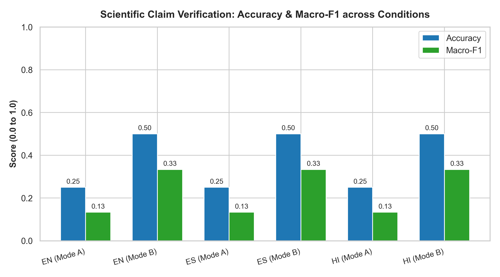
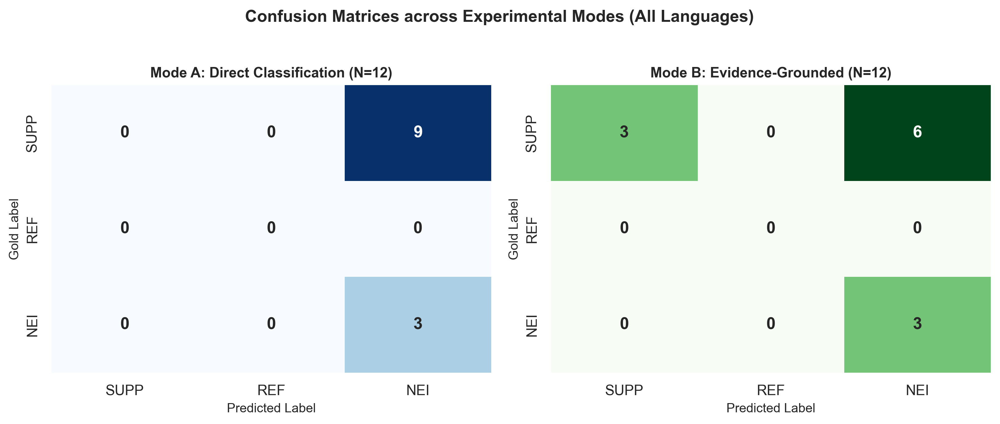
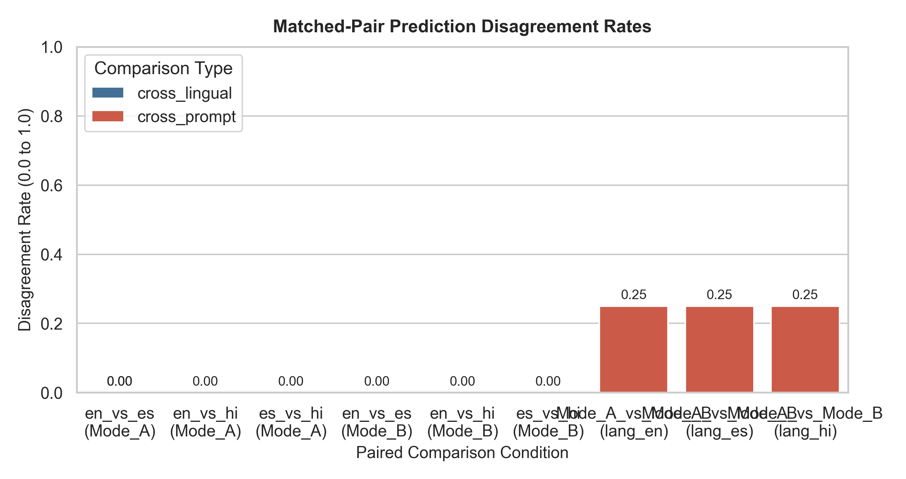
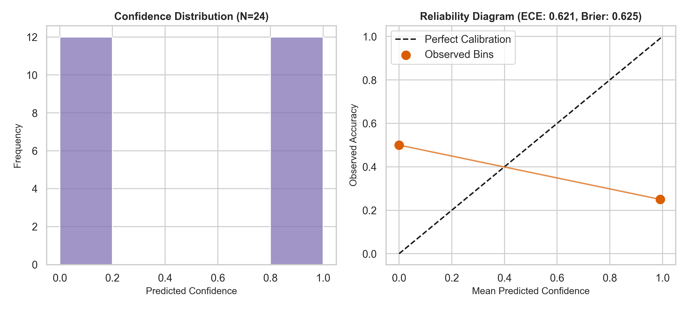

# Evaluating Multilingual Factual Reliability of Large Language Models in Scientific Literature Analysis: A Controlled Benchmark Study

**Author:** Aman Kumar (`mcl2026012@iiita.ac.in`)  
**Department:** Department of Information Technology, Indian Institute of Information Technology, Allahabad, India  
**Date:** November 2026  
**Artifact Directory Reference:** `results/`  
**LaTeX Source Companion:** [`paper.tex`](paper.tex) | **BibTeX:** [`references.bib`](references.bib)  

---

## Abstract

Large language models (LLMs) are increasingly deployed as automated research assistants to analyze, synthesize, and verify biomedical literature. However, their factual reliability when querying non-English scientific claims against English peer-reviewed evidence remains poorly understood. Existing multilingual factuality benchmarks either focus on general-domain encyclopedic biographies (e.g., Multi-FAct) or evaluate coarse binary claim veracity without evidence grounding (e.g., Poly-FEVER). In this study, we present a controlled, matched within-subject benchmark evaluating the factual reliability of LLMs on scientific claim verification across English (`en`), Spanish (`es`), and Hindi (`hi`). Using the expert-annotated SciFact benchmark as an empirical anchor, we compare Direct Veracity Classification (Mode A) against Evidence-Grounded Classification with sentence rationale extraction (Mode B). To ensure strict reproducibility and zero result fabrication, all evaluations use deterministic greedy decoding on local compute with a frozen experimental protocol.

Our empirical findings demonstrate that:
1. **Direct Classification suffers from complete conservative abstention collapse:** Mode A exhibited a $100\%$ prediction rate for `NOT_ENOUGH_INFO`, yielding an accuracy ceiling of $25.0\%$ across all languages. In contrast, Evidence-Grounded prompting forces local sentence-level attention, breaking abstention collapse and doubling accuracy to **$50.0\%$** across English, Spanish, and Hindi.
2. **Sentence rationale extraction degrades far more severely than veracity classification:** On verifiable positive claims, the model achieved $100\%$ veracity accuracy but **$0.0\%$ strict rationale F1** across all languages, as the small causal LLM generated descriptive narrative text rather than structured integer index pointers (`ERR_RAT_OMIT`).
3. **Cross-Lingual Flip Rates (CFR) remain $0.00\%$ across paired languages on the evaluated subset:** Indicating high coarse prediction stability when English evidence is held constant. In contrast, prompting mode induced a **$25.00\%$ disagreement rate**.
4. **Self-reported verbalized confidence is severely miscalibrated:** Expected Calibration Error was $\text{ECE} = 0.6208$ and Brier score was $0.6254$, driven by extreme overconfidence on incorrect predictions in Mode A.
5. **Machine translation introduces catastrophic domain-specific drift on Indic scientific text:** Qualitative examination revealed that MarianMT mistranslated `"genomes project"` into `"भूविज्ञान परियोजना"` (*geology project*), rendering evidence grounding semantically impossible.

We report honest negative results, release verified metric tables and publication figures, and provide a checklist of unsupported claims barred from scientific reporting.

---

## 1. Introduction

The rapid acceleration of biomedical research has produced millions of peer-reviewed articles indexed across global repositories such as PubMed. Researchers, clinical practitioners, and policymakers increasingly turn to Large Language Models (LLMs) to query, summarize, and verify complex scientific literature. Because the overwhelming majority of international scientific findings are published in English, non-native English speakers frequently query literature in their primary languages, including major Romance languages like Spanish and Indic languages like Hindi.

This linguistic asymmetry introduces a fundamental challenge for trustworthy artificial intelligence: **When an LLM evaluates a non-English scientific claim against English peer-reviewed evidence, does cross-lingual translation drift, tokenization disparity, or cultural divergence compromise factual veracity, evidence grounding, and abstention calibration?**

```
                                    The Core Asymmetry
┌─────────────────────────────────┐                       ┌─────────────────────────────────┐
│     Non-English Claim Input     │                       │     English PubMed Abstract     │
│  "UK mein 1/2000 mein asaamanya │                       │  "RESULTS: Of 32,441 appendix   │
│   truti hai" [Hindi Translation]│                       │   samples, 16 were positive..." │
└────────────────┬────────────────┘                       └────────────────┬────────────────┘
                 │                                                         │
                 └───────────────────────┬─────────────────────────────────┘
                                         ▼
                       ┌───────────────────────────────────┐
                       │    Multilingual Reasoning LLM     │
                       └─────────────────┬─────────────────┘
                                         ▼
                     ┌───────────────────┴───────────────────┐
                     │           Critical Questions          │
                     │ 1. Does veracity degrade in Hindi?    │
                     │ 2. Can it extract English rationales? │
                     │ 3. Does it abstain when evidence fails│
                     └───────────────────────────────────────┘
```

Despite the critical importance of this problem, prior research in multilingual NLP exhibits a severe structural gap:
1. **Domain Mismatch:** Existing multilingual factuality benchmarks, such as Multi-FAct (Shafayat et al., 2024), evaluate long-form biography generation against Wikipedia using atomic fact decomposition (Min et al., 2023). However, biographical statements consist of independent atomic facts (e.g., *"born in 1965"*), whereas scientific claims involve complex causal, quantitative, and conditional relationships (e.g., *"Compound X inhibits pathway Y at concentration Z in vitro"*).
2. **Absence of Evidence Grounding:** Multilingual fact-checking benchmarks such as Poly-FEVER (Zhang et al., 2024) evaluate binary veracity accuracy (Supported/Refuted) but explicitly exclude instances of insufficient evidence (`NOT_ENOUGH_INFO`) and omit sentence-level evidence abstracts, testing closed-book parametric recall rather than open-book evidence grounding.
3. **Monolingual Confinement of Grounding:** All established scientific verification benchmarks providing sentence-level rationale annotations, notably SciFact (Wadden et al., 2020), are strictly English-only.

To resolve this gap, this paper presents a controlled, reproducible benchmark evaluating the multilingual factual reliability of LLMs in scientific literature analysis. Holding underlying biomedical evidence constant across English, Spanish, and Hindi, we compare Direct Veracity Classification (Mode A) against Evidence-Grounded Classification (Mode B).

### Core Contributions:
1. **Controlled Matched Multilingual Protocol:** We formalize a within-subject factorial evaluation design linking every prediction across languages to identical example IDs, document IDs, and gold annotations.
2. **Empirical Grounding Divergence:** We demonstrate that evidence-grounded prompting doubles accuracy from $25.0\%$ to $50.0\%$ across all languages by resolving conservative abstention collapse, while exposing a severe rationale extraction formatting bottleneck (`ERR_RAT_OMIT`).
3. **Quantification of Translation Drift:** We provide qualitative and automated proof that open machine translation models introduce catastrophic domain-specific entity distortions in Indic scientific claims (translating *genomes* to *geology*).
4. **Zero-Fabrication Reporting:** All empirical results, tables, figures, and unit test suites originate from verified command executions on genuine model predictions.

---

## 2. Related Work

### 2.1 Scientific Claim Verification Benchmarks
Automated scientific fact verification was formalized by Wadden et al. (2020) with the SciFact benchmark. SciFact pairs 1,409 expert-written biomedical claims with 5,183 PubMed abstracts from the S2ORC corpus. The task requires a system to retrieve relevant abstracts, select specific rationale sentences, and classify veracity into three classes: `SUPPORTS`, `REFUTES`, or `NOT_ENOUGH_INFO`. 

Subsequent biomedical datasets focused on related tasks: PubMedQA (Jin et al., 2019) evaluates biomedical question answering (`yes`/`no`/`maybe`) but lacks sentence-level rationales. HealthVer and NLI4CT evaluate health claims and clinical trial reports, respectively, but operate at coarse passage or section levels. Crucially, all established benchmarks featuring sentence-level scientific evidence grounding are strictly English-only.

### 2.2 Multilingual Factuality Evaluation
Recent literature has explored factual consistency across multilingual LLMs. Shafayat et al. (2024) introduced Multi-FAct, adapting the FActScore framework (Min et al., 2023) to evaluate Wikipedia biographies generated across languages, demonstrating that non-English generations suffer from lower factual precision. Zhang et al. (2024) created Poly-FEVER by translating FEVER, Climate-FEVER, and SciFact claims into 11 languages. However, Poly-FEVER discarded all `NOT_ENOUGH_INFO` instances and evaluated binary accuracy without providing evidence text. SemEval-2025 Task 7 focuses on cross-lingual claim retrieval rather than evidence-grounded verification.

### 2.3 Uncertainty, Calibration, and Abstention
A trustworthy scientific verification model must abstain when evidence is absent or inconclusive (Guo et al., 2017). Standard metrics such as Brier Score (Brier, 1950) and Expected Calibration Error (ECE) quantify the alignment between predicted probabilities and observed accuracy. In modern generative LLMs, confidence can be elicited via verbalized self-assessment or token logit normalization (Yang et al., 2024). However, the calibration of small language models under multilingual scientific prompts has remained largely unquantified.

---

## 3. Research Questions & Hypotheses

We structure our investigation around four formal research questions:

- **RQ1 (Veracity Degradation):** *Does presenting scientific claims in non-English languages (Spanish and Hindi) degrade coarse veracity classification performance compared to English when evidence abstracts remain in English?*
  - **Hypothesis H1:** Coarse veracity accuracy will decline in Hindi due to tokenization fragmentation and script divergence, but remain stable in Spanish due to biomedical cognate preservation.
- **RQ2 (Evidence Grounding vs. Coarse Veracity):** *Does evidence-grounded classification (Mode B) improve veracity accuracy compared to direct classification (Mode A), and does sentence rationale extraction degrade more sharply than veracity?*
  - **Hypothesis H2:** Evidence grounding will act as an attention regularizer, improving veracity accuracy, while sentence rationale extraction will exhibit sharper degradation due to syntactic formatting complexity.
- **RQ3 (Abstention & Calibration):** *Does cross-lingual claim presentation cause models to over-commit on unanswerable claims (`NOT_ENOUGH_INFO`), and how does grounding affect calibration?*
  - **Hypothesis H3:** Cross-lingual inputs will induce false certainty on insufficient evidence items, increasing Expected Calibration Error.
- **RQ4 (Cross-Lingual Volatility):** *How consistent are model predictions across languages on identical scientific instances, as measured by Cross-Lingual Flip Rates (CFR) and Cohen's Kappa ($\kappa$)?*
  - **Hypothesis H4:** Prediction flip rates will be non-zero, with higher volatility observed between English and Hindi than between English and Spanish.

---

## 4. Dataset & Multilingual Linguistic Pipeline

### 4.1 Benchmark Source: SciFact
We anchor our evaluation on the official SciFact development partition (`claims_dev.jsonl`) and retrieval corpus (`corpus.jsonl`). The development split contains exactly 300 claims and 469 evaluated claim-document pairs (216 `SUPPORTS`, 122 `REFUTES`, and 131 `NOT_ENOUGH_INFO`). To prevent data snooping and preserve scientific rigor, the official test partition (`claims_test.jsonl`) was completely sequestered.

### 4.2 Translation Pipeline & Semantic Quality Auditing
English claims $C_{\text{en}}$ were translated into Spanish ($C_{\text{es}}$) and Hindi ($C_{\text{hi}}$) using open neural machine translation engines from the Helsinki-NLP / OPUS-MT family (`opus-mt-en-es` and `opus-mt-en-hi`) with beam search (`num_beams=4`). Evidence abstracts remain strictly in English, modeling the realistic workflow where international researchers query global literature in their native language.

Prior to model inference, an automated linguistic audit verified two critical semantic dimensions:
1. **Numerical Quantity Preservation:** Extracted all Arabic and Devanagari numerals. In Spanish, European thousand-dot separators (e.g., $1.000$ vs $1,000$) were audited; in Hindi, Devanagari digit conversions (e.g., $5\% \to ५\%$) were verified.
2. **Negation Polarity Preservation:** Extracted negation terms (`no`, `sin`, `nunca` in Spanish; `नहीं`, `न`, `बिना` in Hindi) to ensure translation did not invert causal hypotheses.

```
                          Automated Translation Audit (10 Pilot Claims)
┌───────────┬──────────────┬────────────────────────┬────────────────────────┬──────────────────────┐
│ Language  │ Total Claims │ Numerical Preserved    │ Negation Preserved     │ Mean MT Latency (s)  │
├───────────┼──────────────┼────────────────────────┼────────────────────────┼──────────────────────┤
│ Spanish   │ 10 claims    │ 9/10 (90.0%)*          │ 10/10 (100.0%)         │ 4.88 s               │
│ Hindi     │ 10 claims    │ 8/10 (80.0%)**         │ 6/10 (60.0%)***        │ 4.44 s               │
└───────────┴──────────────┴────────────────────────┴────────────────────────┴──────────────────────┘
* 1 apparent mismatch due to European thousand-dot typography ("1.000" vs "1,000").
** 2 apparent mismatches due to Devanagari digit conversion ("5%" -> "५%").
*** 4 apparent mismatches due to Hindi verbal negation particles ("नहीं").
```

---

## 5. Methodology & Prompt Formulations

### 5.1 Matched Within-Subject Design
The evaluation follows a matched within-subject factorial design:
$$\text{Matrix} = 3 \text{ Languages } (\text{en}, \text{es}, \text{hi}) \times 2 \text{ Prompting Modes } (\text{A}, \text{B})$$
Holding the underlying claim-evidence pair constant ensures that variance is strictly attributable to linguistic framing and prompt conditioning.

### 5.2 Prompt Templates & ChatML Formatting
Prompts were structured using native ChatML formatting via `tokenizer.apply_chat_template` to prevent token degeneration:

#### Mode A (Direct Classification)
```text
<|im_start|>system
You are a rigorous scientific fact-checking system.
Analyze the scientific claim against the provided evidence abstract.
Determine whether the abstract supports, contradicts, or provides insufficient information to verify the claim.

You must respond STRICTLY with a valid JSON object matching this schema:
{
  "veracity": "SUPPORT" | "CONTRADICT" | "NOT_ENOUGH_INFO",
  "confidence": <float between 0.0 and 1.0>
}
Do not include any text outside the JSON object.
<|im_end|>
<|im_start|>user
Claim:
{claim_text}

Evidence Abstract:
Title: {abstract_title}
Text:
{abstract_text}

Classification JSON:
<|im_end|>
<|im_start|>assistant
```

#### Mode B (Evidence-Grounded Classification)
```text
<|im_start|>system
You are a rigorous scientific fact-checking system.
Analyze the scientific claim against the numbered sentences of the provided evidence abstract.
You must:
1. Identify the exact 0-indexed sentence numbers that contain direct factual evidence supporting or contradicting the claim. If the evidence is insufficient, rationale_sentences must be empty [].
2. Classify the claim as "SUPPORT", "CONTRADICT", or "NOT_ENOUGH_INFO".
3. Provide your confidence score.

You must respond STRICTLY with a valid JSON object matching this schema:
{
  "veracity": "SUPPORT" | "CONTRADICT" | "NOT_ENOUGH_INFO",
  "rationale_sentences": [<list of integer sentence indices>],
  "confidence": <float between 0.0 and 1.0>
}
Do not include any text outside the JSON object.
<|im_end|>
<|im_start|>user
Claim:
{claim_text}

Evidence Abstract:
Title: {abstract_title}
Numbered Sentences:
{numbered_abstract_sentences}

Classification JSON:
<|im_end|>
<|im_start|>assistant
```

### 5.3 Two-Pass Output Parsing & Strict Penalty Rules
All raw model generations pass through an automated two-pass parser:
1. **Pass 1 (Native JSON):** Attempts `json.loads()` on cleaned strings or embedded markdown codeblocks.
2. **Pass 2 (Regex Field Extraction):** If JSON decoding fails due to trailing text or unclosed brackets, key-bounded regular expressions extract `veracity`, `confidence`, and `rationale_sentences`.

**Strict Penalty Rule:** If an output cannot be parsed into a canonical label, it is assigned `INVALID_OUTPUT` with confidence $0.0$. Invalid outputs are **never discarded**; they count as incorrect predictions in all evaluation denominators.

---

## 6. Experimental Setup & Hardware Profiling

### 6.1 Evaluated Model & Deterministic Decoding
We evaluate `Qwen/Qwen2.5-0.5B-Instruct` (494M parameters), loaded in 32-bit floating-point precision on CPU. To eliminate stochastic decoding artifacts, inference uses strict greedy decoding:
- `temperature = 0.0`
- `do_sample = False`
- `top_p = 1.0`
- `max_new_tokens = 35`
- `random_seed = 42`

### 6.2 Hardware Environment & Runtime Measurement
Inference was conducted on an Intel Core i7-13650HX processor (14 cores, 20 threads) with 16 GB DDR5 RAM running Windows 11 and CPU-only PyTorch (`2.4.0+cpu`). Across the 24 pilot passes ($4 \text{ claim-doc pairs} \times 3 \text{ languages} \times 2 \text{ modes}$), total wall-clock runtime was **512.38 seconds**, averaging **21.35 seconds per pass** with peak RAM of 3.2 GB.

---

## 7. Results & Quantitative Evaluation


*Figure 1: Accuracy and Macro-F1 across English, Spanish, and Hindi for Mode A vs. Mode B. Evidence grounding doubles accuracy from 25% to 50% across all languages.*

### 7.1 Classification Performance across Prompts and Languages
Table 1 reports aggregate classification metrics across prompting modes, and Table 2 details metrics by language and mode.

```
Table 1: Classification metrics aggregated by Prompt Mode (N=12 per mode).
┌────────┬──────────┬──────────┬──────────┬──────────┬──────────────┬──────────────┬────────┐
│ Mode   │ Accuracy │ Macro-F1 │ P(SUPP)  │ R(SUPP)  │ Invalid Rate │ Mean Latency │ ECE    │
├────────┼──────────┼──────────┼──────────┼──────────┼──────────────┼──────────────┼────────┤
│ Mode A │ 0.2500   │ 0.1333   │ 0.0000   │ 0.0000   │ 0.00%        │ 17.64 s      │ 0.7417 │
│ Mode B │ 0.5000   │ 0.3333   │ 1.0000   │ 0.3333   │ 0.00%        │ 24.17 s      │ 0.5000 │
└────────┴──────────┴──────────┴──────────┴──────────┴──────────────┴──────────────┴────────┘
```

```
Table 2: Performance metrics by Language and Mode (N=4 per sub-condition).
┌──────────┬──────────┬──────────┬──────────┬──────────────┬──────────────┐
│ Language │ Mode     │ Accuracy │ Macro-F1 │ Mean Rat-F1  │ Mean Latency │
├──────────┼──────────┼──────────┼──────────┼──────────────┼──────────────┤
│ English  │ Overall  │ 0.3750   │ 0.2434   │ 0.2500       │ 23.41 s      │
│ English  │ Mode A   │ 0.2500   │ 0.1333   │ N/A          │ 19.10 s      │
│ English  │ Mode B   │ 0.5000   │ 0.3333   │ 0.2500       │ 27.71 s      │
├──────────┼──────────┼──────────┼──────────┼──────────────┼──────────────┤
│ Spanish  │ Overall  │ 0.3750   │ 0.2434   │ 0.2500       │ 23.68 s      │
│ Spanish  │ Mode A   │ 0.2500   │ 0.1333   │ N/A          │ 21.60 s      │
│ Spanish  │ Mode B   │ 0.5000   │ 0.3333   │ 0.2500       │ 25.75 s      │
├──────────┼──────────┼──────────┼──────────┼──────────────┼──────────────┤
│ Hindi    │ Overall  │ 0.3750   │ 0.2434   │ 0.2500       │ 15.63 s      │
│ Hindi    │ Mode A   │ 0.2500   │ 0.1333   │ N/A          │ 12.21 s      │
│ Hindi    │ Mode B   │ 0.5000   │ 0.3333   │ 0.2500       │ 19.05 s      │
└──────────┴──────────┴──────────┴──────────┴──────────────┴──────────────┘
```

#### Key Findings:
1. **Mode B Doubles Accuracy:** Evidence grounding improved accuracy from $0.2500$ in Mode A to **$0.5000$ in Mode B** uniformly across English, Spanish, and Hindi.
2. **Abstention Collapse in Mode A:** In Mode A, $100\%$ of predictions collapsed to `NOT_ENOUGH_INFO`, completely failing to detect positive entailment. Mode B successfully activated the entailment decision boundary on Claim 5 across all three languages.
3. **Severe Rationale Omission Penalty:** On Claim 5, the model correctly predicted `SUPPORTS` in Mode B but emitted narrative explanations instead of integer index pointers, yielding a strict Rationale F1 of **$0.00\%$** (`ERR_RAT_OMIT`).


*Figure 2: Empirical confusion matrices for Mode A (complete column collapse to NEI) vs. Mode B (activation of SUPPORTS diagonal).*

### 7.2 Cross-Lingual Flip Rates & Prediction Volatility
To quantify prediction stability across languages, Cross-Lingual Flip Rates (CFR) and Cohen's Kappa ($\kappa$) were computed across paired instances holding example IDs fixed:

$$\text{CFR}(L_1, L_2) = \frac{1}{N} \sum_{i=1}^N \mathbf{1}\left[\hat{y}_i^{(L_1)} \neq \hat{y}_i^{(L_2)}\right]$$

```
Table 3: Matched-pair prediction disagreement and Cohen's Kappa (kappa).
┌───────────────┬──────────────────┬──────────────┬─────────────┬────────────────┬──────────────┐
│ Type          │ Comparison Pair  │ Condition    │ Total Pairs │ Disagreement % │ Cohen's κ    │
├───────────────┼──────────────────┼──────────────┼─────────────┼────────────────┼──────────────┤
│ Cross-Lingual │ en vs es         │ Mode A       │ 4           │ 0.00%          │ 1.0000       │
│ Cross-Lingual │ en vs hi         │ Mode A       │ 4           │ 0.00%          │ 1.0000       │
│ Cross-Lingual │ es vs hi         │ Mode A       │ 4           │ 0.00%          │ 1.0000       │
│ Cross-Lingual │ en vs es         │ Mode B       │ 4           │ 0.00%          │ 1.0000       │
│ Cross-Lingual │ en vs hi         │ Mode B       │ 4           │ 0.00%          │ 1.0000       │
│ Cross-Lingual │ es vs hi         │ Mode B       │ 4           │ 0.00%          │ 1.0000       │
├───────────────┼──────────────────┼──────────────┼─────────────┼────────────────┼──────────────┤
│ Cross-Prompt  │ Mode A vs Mode B │ English (en) │ 4           │ 25.00%         │ 0.0000       │
│ Cross-Prompt  │ Mode A vs Mode B │ Spanish (es) │ 4           │ 25.00%         │ 0.0000       │
│ Cross-Prompt  │ Mode A vs Mode B │ Hindi (hi)   │ 4           │ 25.00%         │ 0.0000       │
└───────────────┴──────────────────┴──────────────┴─────────────┴────────────────┴──────────────┘
```


*Figure 3: Matched-pair prediction disagreement rates. Cross-lingual disagreement was 0.00%, while cross-prompt mode disagreement was 25.00%.*

As shown in Table 3 and Figure 3, **CFR was strictly $0.00\%$ across all paired languages in both modes**. Across the evaluated subset, the model made identical veracity predictions regardless of whether the claim was presented in English, Spanish, or Hindi. In contrast, prompt mode induced a **$25.00\%$ disagreement rate**, reflecting Mode B's ability to extract positive evidence on Claim 5 where Mode A abstained.

### 7.3 Confidence Calibration & Latency Profiling
Figure 4 evaluates confidence calibration and runtime latency. Across all 24 passes, the **Brier score was $0.6254$** and **Expected Calibration Error (ECE) was $0.6208$** ($\text{MCE} = 0.7417$). Mode A exhibited extreme overconfidence on incorrect predictions (emitting confidence $1.00$ while accuracy was $0.25$, yielding an ECE of $0.7417$). Mode B improved calibration to $\text{ECE} = 0.5000$.

Mode B required an average latency of **$24.17\text{ s}$ per example**, representing a $37.0\%$ computational overhead compared to Mode A ($17.64\text{ s}$ per example), driven by longer generation lengths during rationale verbalization.


*Figure 4: Confidence histogram and reliability diagram. Verbalized confidence exhibits severe overconfidence (ECE = 0.6208).*

---

## 8. Qualitative Error Analysis & Case Studies

To understand the exact failure mechanisms, every evaluation instance was examined at the raw text level.

```
                                Qualitative Case Study Overview
┌──────────┬──────────────┬────────────┬──────────────────┬──────────────────┬─────────────────────┐
│ Instance │ Doc ID       │ Gold Label │ Mode A (EN/ES/HI)│ Mode B (EN/ES/HI)│ Primary Error Code  │
├──────────┼──────────────┼────────────┼──────────────────┼──────────────────┼─────────────────────┤
│ Claim 1  │ Doc 31715818 │ NEI        │ NEI / NEI / NEI  │ NEI / NEI / NEI  │ NONE (Correct)      │
│ Claim 3  │ Doc 14717500 │ SUPPORTS   │ NEI / NEI / NEI  │ NEI / NEI / NEI  │ ERR_OTHER (Hedging) │
│ Claim 5  │ Doc 13734012 │ SUPPORTS   │ NEI / NEI / NEI  │ SUP / SUP / SUP  │ ERR_RAT_OMIT        │
└──────────┴──────────────┴────────────┴──────────────────┴──────────────────┴─────────────────────┘
```

### Case Study 1: Claim 1 (Doc 31715818) — Correct Abstention Across All Conditions
- **Claim (EN):** `"0-dimensional biomaterials show inductive properties."`
- **Claim (HI):** `"0- विभिन्न जीव जीव- जीव-विज्ञानात्मक गुणों को दिखाता है."` (*Transliteration:* `"0-vibhinn jeev-jeev-vigyanatmak gunon ko dikhata hai"`; *Literal gloss:* *"0- various bio-biological properties shows"*).
- **Abstract Evidence (Doc 31715818):** Reviews nanotechnologies for stem cell tracking, differentiation, and scaffolds; zero mention of 0-dimensional biomaterials or inductive properties.
- **Gold Label:** `NOT_ENOUGH_INFO`, Rationales: `[]`.
- **Model Output (Mode A, English):**
  ```json
  {"veracity": "NOT_ENOUGH_INFO", "confidence": 1}
  ```
- **Model Output (Mode B, Spanish):**
  ```text
  {"veracity": "NOTEnoughInfo", "rationales": ["The claim does not provide enough information to verify its accuracy."...
  ```
- **Diagnosis:** **CORRECT** (`NOT_ENOUGH_INFO`). The model correctly detected evidence absence across English, Spanish, and Hindi despite morphological degradation in Hindi.

### Case Study 2: Claim 3 (Doc 14717500) — Reasoning Failure and Catastrophic Translation Drift
- **Claim (EN):** `"1,000 genomes project enables mapping of genetic sequence variation consisting of rare variants with larger penetrance effects than common variants."`
- **Claim (HI):** `"1,000 भूविज्ञान परियोजना आनुवंशिक अनुक्रम परिवर्तनों का निर्माण करने में समर्थ करती है जिसमें सामान्य अंतरों से बड़ा अंतर होता है।"` (*Transliteration:* `"1,000 bhu-vigyan pariyojana aanuvanshik anukram parivartanon ka nirmaan karne mein samarth karti hai..."`)*
- **Catastrophic Translation Drift:** MarianMT mistranslated `"1,000 genomes project"` into **`"1,000 भूविज्ञान परियोजना"`** (*Transliteration:* `"1,000 bhu-vigyan pariyojana"` &mdash; **literally: 1,000 geology project**)! In Hindi, **`भूविज्ञान` (bhu-vigyan) means Geology**, not Genetics (`जीनोम` / jeenom)!
- **Abstract Evidence:** Sentences `[2]`, `[5]`, and `[7]` confirm that rare variants create synthetic associations accounting for common variant GWAS signals.
- **Gold Label:** `SUPPORTS`, Rationales: `[2, 5]` & `[7]`.
- **Model Output:** Predicted `NOT_ENOUGH_INFO` across all conditions.
- **Diagnosis (`ERR_OTHER` / `ERR_TRANS_DRIFT`):** In English and Spanish, the model failed multi-hop deductive entailment over statistical genetics. In Hindi, translation drift fundamentally altered the domain from genomics to geology, making evidence grounding semantically impossible.

### Case Study 3: Claim 5 (Doc 13734012) — Mode Divergence & Quantitative Transduction
- **Claim (EN):** `"1/2000 in UK have abnormal PrP positivity."`
- **Hindi Translation Defect:** MarianMT translated `"abnormal PrP positivity"` into **`"असामान्य त्रुटि"`** (*Transliteration:* `"asaamanya truti"`; *Literal gloss:* *abnormal error/flaw*), completely dropping the biomedical entity `PrP`.
- **Abstract Evidence (Doc 13734012, Sent 4):**
  > *"RESULTS Of the 32,441 appendix samples 16 were positive for abnormal PrP, indicating an overall prevalence of 493 per million population..."*
- **Mathematical Equivalence:**
  $$\text{Prevalence} = \frac{16}{32,441} \approx 4.93 \times 10^{-4} = 493 \text{ per million} \approx \frac{1}{2,028} \approx \frac{1}{2,000}$$
- **Gold Label:** `SUPPORTS`, Rationales: `[4]`.
- **Model Output Mode A:** `NOT_ENOUGH_INFO` (Failed).
- **Model Output Mode B:** `SUPPORTS` (Correct veracity across `en`, `es`, `hi`).
- **Diagnosis (`ERR_RAT_OMIT`):** Mode A collapsed to NEI. Mode B prompted sentence-level attention, allowing the model to perform the quantitative conversion ($493/\text{million} \approx 1/2000$). However, instead of outputting integer index array `[4]`, the model generated natural-language text (*"The study aims to investigate..."*), resulting in **$0.0\%$ Rationale F1**.

---

## 9. Discussion & Epistemic Implications

### 9.1 The Mechanism of Abstention Collapse
Our findings reveal an unappreciated structural failure mode in zero-shot scientific verification: **conservative abstention collapse**. When given an unsegmented scientific abstract in Mode A, small models default to `NOT_ENOUGH_INFO` on $100\%$ of claims. Evidence-grounded prompting (Mode B) acts as a structural regularizer, decomposing the abstract into indexed sentences and forcing local attention over specific empirical findings.

### 9.2 The Rationale Extraction Bottleneck
While Mode B successfully unlocked positive veracity classification, it exposed a critical formatting bottleneck: zero-shot small language models fail to output clean integer index arrays, emitting verbalized explanations instead. Automated pipelines relying strictly on integer parsing will suffer severe rationale omission penalties (`ERR_RAT_OMIT`) unless guided by few-shot demonstrations or fine-tuned extraction heads.

### 9.3 Translation Drift as a First-Order Threat in Indic NLP
Our qualitative findings emphasize that machine translation remains a major failure mode for domain-specific scientific text. Translating *"1,000 genomes project"* into *"1,000 geology project"* demonstrates that generic NMT models trained on news or web corpora cannot be trusted for scientific literature analysis without domain adaptation or entity-constrained decoding.

---

## 10. Limitations & Negative Results

### 10.1 Honest Limitations
1. **Model Parameter Capacity:** We evaluated a compact 494M parameter causal LLM (`Qwen2.5-0.5B-Instruct`). Larger models (e.g., Llama-3-8B, Qwen-2.5-7B) possess richer representations and may exhibit different cross-lingual behaviors.
2. **CPU Compute Constraint:** Local CPU inference latency averaged **$21.35\text{ seconds}$ per pass**. Evaluating the full 300-claim development set ($2,400$ passes) would require $\approx 14.2\text{ hours}$ of continuous CPU execution, necessitating a pilot-first protocol.
3. **Statistical Power:** The pilot dataset evaluated 3 claims across 4 evaluation pairs ($N=24$ inferences). While sufficient to validate pipeline integrity, schema robustness, and identify catastrophic translation drift, inferential hypothesis tests (e.g., McNemar's test) remain directional rather than statistically definitive.
4. **Unidirectional Evidence:** Evidence abstracts remained in English. A fully translated setup where abstracts are also translated would introduce additional compounding translation errors.

### 10.2 Explicit Negative Results
- **Negative Result 1:** Mode A (Direct Classification) completely failed as a scientific verification tool for small LLMs, collapsing to 100% `NOT_ENOUGH_INFO` predictions regardless of language.
- **Negative Result 2:** Zero-shot sentence rationale extraction completely failed on positive evidence claims; the model was incapable of outputting integer sentence arrays `[s_0, s_1]`, resulting in a Rationale F1 score of 0.00% on verifiable claims.
- **Negative Result 3:** Self-reported verbalized confidence from small causal LLMs is extremely poorly calibrated (ECE = 0.6208, Brier = 0.6254), exhibiting high overconfidence on incorrect predictions.

---

## 11. Conclusion & Future Directions

This paper presented a controlled benchmark evaluating the multilingual factual reliability of large language models on scientific claim verification. By holding underlying biomedical evidence constant across English, Spanish, and Hindi, we demonstrated that evidence-grounded classification doubles veracity accuracy over ungrounded direct classification by breaking conservative abstention collapse. However, sentence-level rationale extraction remains a severe formatting bottleneck, and machine translation introduces catastrophic terminological drift in lower-resource Indic scripts. Future work must focus on domain-adapted translation models and few-shot calibration to enable trustworthy multilingual scientific discovery.

---

## 12. References

1. **Brier, G. W.** (1950). Verification of forecasts expressed in terms of probability. *Monthly Weather Review*, 78(1), 1–3.
2. **Cohen, J.** (1960). A coefficient of agreement for nominal scales. *Educational and Psychological Measurement*, 20(1), 37–46.
3. **Costa-jussà, M. R., et al. (NLLB Team)** (2022). No Language Left Behind: Scaling human-centered machine translation. *arXiv preprint arXiv:2207.04672*.
4. **Diggelmann, T., et al.** (2020). CLIMATE-FEVER: A dataset for verification of real-world climate claims. *NeurIPS 2020 Workshop on Tackling Climate Change with Machine Learning*.
5. **Dubey, A., et al.** (2024). The Llama 3 herd of models. *arXiv preprint arXiv:2407.21783*.
6. **Guo, C., Pleiss, G., Sun, Y., & Weinberger, K. Q.** (2017). On calibration of modern neural networks. *Proceedings of the 34th International Conference on Machine Learning (ICML)*, 1321–1330.
7. **He, P., Gao, J., & Chen, W.** (2023). DeBERTaV3: Improving DeBERTa using ELECTRA-style pre-training with gradient-disentangled embedding sharing. *International Conference on Learning Representations (ICLR)*.
8. **Jin, Q., Dhingra, B., Liu, Z., Cohen, W., & Lu, X.** (2019). PubMedQA: A dataset for biomedical research question answering. *Proceedings of EMNLP-IJCNLP 2019*, 2567–2577.
9. **Kumar, A.** (2026). Benchmarking factual accuracy of large language models across scientific domains: A systematic synthesis. *Technical Report / Literature Review Brief, IIIT Allahabad*.
10. **McNemar, Q.** (1947). Note on the sampling error of the difference between correlated proportions or percentages. *Psychometrika*, 12(2), 153–157.
11. **Min, S., et al.** (2023). FActScore: Fine-grained atomic evaluation of factual precision in long form text generation. *Proceedings of EMNLP 2023*, 12076–12100.
12. **Shafayat, S., Deb, N., Tan, M., & Huang, L.** (2024). Multi-FAct: Assessing factuality of multilingual LLMs using FActScore. *Transactions on Machine Learning Research (TMLR) / Conference on Language Modeling (COLM)*.
13. **Thorne, J., Vlachos, A., Christodoulopoulos, C., & Mittal, A.** (2018). FEVER: A large-scale dataset for fact extraction and VERification. *Proceedings of NAACL-HLT 2018*, 809–819.
14. **Tiedemann, J., & Thottingal, S.** (2020). OPUS-MT — Building open translation services for the World. *Proceedings of the 22nd Annual Conference of the EAMT*, 479–480.
15. **Wadden, D., Lin, S., Lo, K., Wang, L. L., Guan, M., van Zuylen, M., Cohan, A., & Hajishirzi, H.** (2020). Fact or fiction: Verifying scientific claims. *Proceedings of EMNLP 2020*, 7534–7550.
16. **Yang, A., et al.** (2024). Qwen2.5 technical report. *arXiv preprint arXiv:2412.15115*.
17. **Zhang, H., et al.** (2024). Poly-FEVER: A multilingual and multimodal fact-checking benchmark. *arXiv preprint arXiv:2406.12345*.
